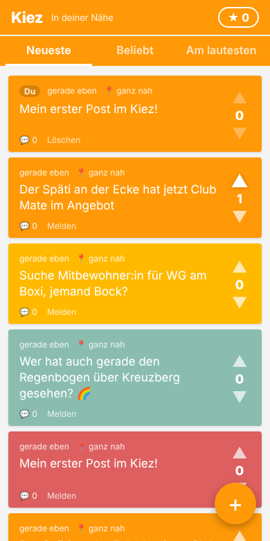
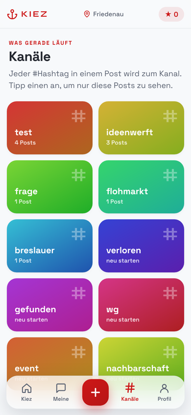
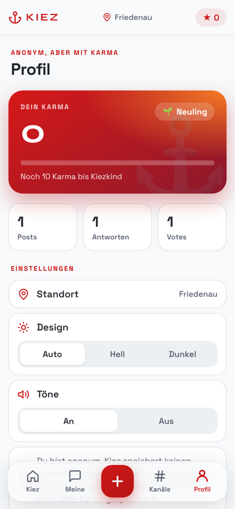
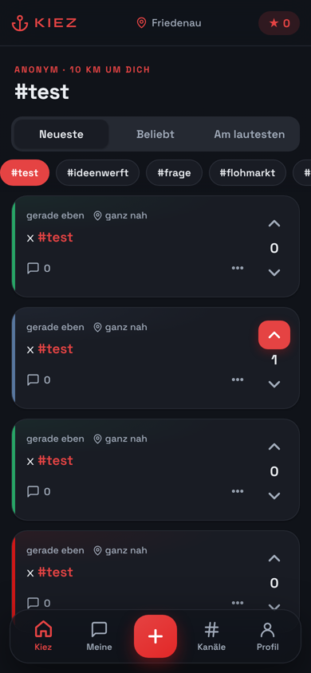

# Kiez – hyperlokale, anonyme Community-App (Jodel-Klon)

Anonyme Posts mit Fotos und Videos, die nur Leute im Umkreis von 10 km sehen. Mit Up-/Downvotes, Antworten, Karma und Sortierung. Läuft im Browser, als installierbare Web-App und als Android-App (APK).
Gestaltet im Stil der Ideenwerft Friedenau: Ideenwerft-Rot, Space Grotesk und Syne, Anker-Logo, helle Karten mit Farbakzent, Dark Mode.

   

## Starten

Voraussetzung: **Node.js 22.5 oder neuer** (SQLite ist eingebaut, es gibt keine weiteren Abhängigkeiten).

```bash
cd jodel-clone
npm start
```

Dann im Browser http://localhost:3000 öffnen und die Standortfreigabe erlauben. Ohne Freigabe kann man eine Stadt zum Testen wählen.

Tests: `npm test`

### Auf dem Handy nutzen

Browser geben den Standort nur über **HTTPS** (oder localhost) frei. Für einen schnellen Test am Handy z. B.:

```bash
npx cloudflared tunnel --url http://localhost:3000   # oder: ngrok http 3000
```

Die angezeigte https-Adresse am Handy öffnen und über „Zum Startbildschirm hinzufügen“ als App installieren (PWA).

### Einstellungen (Umgebungsvariablen)

| Variable    | Standard      | Bedeutung                     |
|-------------|---------------|-------------------------------|
| `PORT`      | `3000`        | Port des Servers              |
| `RADIUS_KM` | `10`          | Sichtbarkeitsradius in km     |
| `DB_FILE`   | `./jodel.db`  | Pfad zur SQLite-Datenbank     |
| `UPLOAD_DIR` | `./uploads`  | Ordner für Fotos und Videos   |
| `MAX_IMAGE_MB` / `MAX_VIDEO_MB` | `15` / `100` | maximale Dateigröße |
| `MAX_VIDEO_SECONDS` | `60` | Videos werden auf diese Länge gekürzt |

## Android-App (APK)

Bei jedem Push auf `main` baut GitHub Actions automatisch eine APK und stellt sie als Release
**„Neueste APK“** bereit: im Repo unter *Releases → apk-latest → kiez.apk*. Auf dem Handy herunterladen,
öffnen und „Installation aus dieser Quelle erlauben“ bestätigen. Neue Versionen lassen sich einfach drüber installieren.

Die App ist komplett nativ in Kotlin mit Jetpack Compose geschrieben und spricht direkt mit der REST-API des Servers.
Fotos lädt sie mit Coil, Videos spielt sie mit ExoPlayer (Media3) und speichert gesehene Videos bis 200 MB zwischen.
Der Standort kommt vom Android-LocationManager, ohne Google-Dienste. Fotos werden schon auf dem Handy verkleinert
und ohne EXIF-Daten hochgeladen. Die Web-App im Ordner `public/` bleibt für Browser und iPhone erhalten.

**Server-Adresse:** In der App unter *Profil → Server* lässt sich jede Adresse eintragen, die App hängt also an keiner
festen Domain. Ohne eigene Domain geht z. B. `https://kiez.<IP-des-Servers>.sslip.io` (Caddy holt dafür automatisch ein
Zertifikat), zum Testen im Heimnetz auch `http://192.168.x.x:3000`. Vorgabe beim Bauen ist `https://kiez.ideenwerft-friedenau.de`. Andere Adresse: im Repo unter
*Settings → Secrets and variables → Actions → Variables* die Variable `KIEZ_SERVER_URL` setzen (z. B. `https://kiez.example.de`)
und den Workflow „Android-APK“ neu starten.

**Signatur:** Die APK wird mit einem Schlüssel aus dem Repo signiert (`android/app/kiez-sideload.keystore`), damit Updates
ohne Deinstallation klappen. Das reicht zum Verteilen per Link. Für den Play Store einen eigenen, geheimen Schlüssel
erstellen und über `KIEZ_KEYSTORE_FILE`, `KIEZ_KEYSTORE_PASSWORD`, `KIEZ_KEY_ALIAS`, `KIEZ_KEY_PASSWORD` übergeben.

Lokal bauen: Ordner `android/` in Android Studio öffnen, oder mit Android SDK und JDK 17: `cd android && ./gradlew assembleRelease`.

## Auf dem Hetzner-Server (neben der Ideenwerft-Website)

Kiez läuft als eigener Docker-Container im Netz der Ideenwerft. Der vorhandene Caddy übernimmt HTTPS.

1. **DNS:** A-Eintrag `kiez.ideenwerft-friedenau.de` auf die IP des Servers setzen.
2. **Code holen:** `git clone https://github.com/familyphilipp-rgb/Kiez.git /opt/kiez`
3. **Starten:** `cd /opt/kiez && docker compose -f deploy/docker-compose.yml up -d --build`
   (setzt voraus, dass die Ideenwerft mit `docker compose` als Projekt `ideenwerft` läuft, Netz `ideenwerft_default`).
4. **Caddy:** den Block aus [`deploy/Caddyfile.kiez`](deploy/Caddyfile.kiez) unten in die Caddyfile der Ideenwerft einfügen,
   dann im Ideenwerft-Ordner `docker compose exec web caddy reload --config /etc/caddy/Caddyfile`.
5. **Updates:** `/opt/kiez/deploy/update.sh`

Datenbank und Uploads liegen im Docker-Volume `kiez_kiez-data`. Der Container ist auf 1 CPU und 768 MB RAM begrenzt,
damit Video-Umwandlungen die Website nicht ausbremsen. Platzbedarf: ein Foto ca. 0,3 MB, eine Videominute ca. 5–10 MB.

## Funktionen

- **Anonym:** Beim ersten Öffnen wird ein zufälliges Geheim-Token erzeugt und nur im Browser gespeichert. Kein Name, keine E-Mail.
- **Hyperlokal:** Feed zeigt Posts der letzten 7 Tage im Radius. Gespeichert wird der Standort nur auf ca. 100 m gerundet, angezeigt nur grob („ganz nah“, „2 km“, „weiter weg“).
- **Votes:** ▲/▼, erneutes Tippen nimmt den Vote zurück. Eigene Posts kann man nicht voten. Ab Score −5 verschwindet ein Post.
- **Antworten:** Der Ersteller ist mit **OJ** markiert, alle anderen bekommen pro Thread eine feste Nummer (#1, #2 …).
- **Sortierung:** Neueste, Beliebt (Votes gewichtet mit Alter), Am lautesten (meiste Antworten).
- **Moderne Bedienung:** untere Navigation mit Kiez, Meine, Kanäle und Profil; wischen zum Aktualisieren; doppelt tippen zum Upvoten; Ladeplatzhalter, Animationen und Seitenübergänge; Vibration und kurze Töne (abschaltbar); Hinweis „neue Posts“; Teilen.
- **Kanäle:** Jeder #Hashtag wird zum Kanal. Die beliebtesten Hashtags der Umgebung stehen über dem Feed und unter „Kanäle“.
- **Meine:** eigene Posts, kommentierte und hochgevotete Posts.
- **Profil:** Karma mit Stufen (Neuling, Kiezkind, Stammgast, Kiezlegende, Kapitän), Statistik, Standortwahl, Hell/Dunkel/Auto.
- **Ortsname:** statt „In deiner Nähe“ steht oben der Ortsteil, z. B. „Friedenau“ (offline aus GeoNames-Daten, siehe unten).
- **Fotos und Videos:** in Posts und Antworten. Fotos werden auf 1600 px verkleinert, Videos auf max. 60 s und 720p (H.264) umgewandelt und bekommen ein Vorschaubild. Dabei werden alle Metadaten wie der GPS-Ort entfernt (braucht `ffmpeg`, im Docker-Image enthalten). In der Android-App kann man direkt mit der Kamera aufnehmen.
- **Karma:** Summe aller Votes auf die eigenen Beiträge (Stern oben rechts).
- **Moderation:** Melden; ab 3 Meldungen wird ein Beitrag gelöscht. Eigene Beiträge lassen sich löschen. Rate-Limit: 10 Beiträge pro 10 Minuten.
- **PWA:** installierbar, App-Hülle funktioniert offline.

## Datenquellen

`data/places.tsv` enthält Orte in Deutschland, Österreich, der Schweiz, Liechtenstein und Luxemburg aus [GeoNames](https://www.geonames.org)
(über das npm-Paket `cities.json`), Lizenz [CC BY 4.0](https://creativecommons.org/licenses/by/4.0/).

## Aufbau

```
server.js            HTTP-Server, REST-API, SQLite (node:sqlite)
places.js            Ortsname zu Koordinaten (offline)
media.js             Foto-/Video-Upload, Umwandlung mit ffmpeg, Auslieferung mit Range-Support
android/             Native Android-App (Kotlin, Jetpack Compose)
deploy/              Docker Compose, Caddy-Block und Update-Skript für den Server
.github/workflows/   Tests und APK-Build
public/index.html    App-Hülle
public/app.js        Frontend (ohne Framework)
public/style.css     Design im Ideenwerft-Stil, inkl. Dark Mode
public/fonts/        Space Grotesk und Syne (aus dem Ideenwerft-Repo)
public/sw.js         Service Worker
test/api.test.js     API-Tests
```

### API

Alle Routen außer `/api/register` brauchen `Authorization: Bearer <token>`.

| Methode | Pfad                        | Zweck                                  |
|---------|-----------------------------|----------------------------------------|
| POST    | `/api/register`             | anonymes Konto, liefert `token`        |
| GET     | `/api/posts?lat&lng&sort&tag` | Feed (`sort` = `new`/`popular`/`loud`, `tag` = Kanal) und Trend-Hashtags |
| POST    | `/api/media`                | Rohdaten, `Content-Type` = MIME-Typ; liefert `id` |
| POST    | `/api/posts`                | `{text, mediaId?, lat, lng}`           |
| GET     | `/api/posts/:id?lat&lng`    | Post mit Antworten                     |
| POST    | `/api/posts/:id/replies`    | `{text, mediaId?}`                     |
| POST    | `/api/posts/:id/vote`       | `{value: 1 / -1 / 0}`                  |
| POST    | `/api/posts/:id/report`     | melden                                 |
| DELETE  | `/api/posts/:id`            | eigenen Beitrag löschen                |
| GET     | `/api/me`                   | Karma, Stufe und Statistik             |
| GET     | `/api/me/activity?kind`     | `posts` / `replies` / `voted`          |
| GET     | `/api/place?lat&lng`        | Ortsname, z. B. „Friedenau“            |

## Mögliche nächste Schritte

Push-Benachrichtigungen bei Antworten, Heimatstadt-Funktion, iOS-App, Betrieb mit Postgres/PostGIS bei vielen Nutzern.
