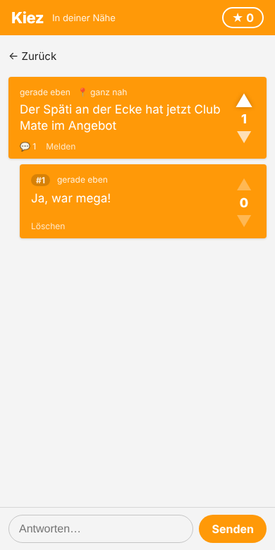

# Kiez – hyperlokale, anonyme Community-App (Jodel-Klon)

Anonyme Posts, die nur Leute im Umkreis von 10 km sehen. Mit Up-/Downvotes, Antworten, Karma und Sortierung.

 

## Starten

Voraussetzung: **Node.js 22.5 oder neuer** (SQLite ist eingebaut, es gibt keine weiteren Abhängigkeiten).

```bash
cd jodel-clone
npm start
```

Dann im Browser http://localhost:3000 öffnen und die Standortfreigabe erlauben. Ohne Freigabe kann man eine Stadt zum Testen wählen.

Tests: `npm test`

### Auf dem Handy nutzen

Browser geben den Standort nur über **HTTPS** (oder localhost) frei. Für einen schnellen Test am Handy z. B.:

```bash
npx cloudflared tunnel --url http://localhost:3000   # oder: ngrok http 3000
```

Die angezeigte https-Adresse am Handy öffnen und über „Zum Startbildschirm hinzufügen“ als App installieren (PWA).

### Einstellungen (Umgebungsvariablen)

| Variable    | Standard      | Bedeutung                     |
|-------------|---------------|-------------------------------|
| `PORT`      | `3000`        | Port des Servers              |
| `RADIUS_KM` | `10`          | Sichtbarkeitsradius in km     |
| `DB_FILE`   | `./jodel.db`  | Pfad zur SQLite-Datenbank     |

## Funktionen

- **Anonym:** Beim ersten Öffnen wird ein zufälliges Geheim-Token erzeugt und nur im Browser gespeichert. Kein Name, keine E-Mail.
- **Hyperlokal:** Feed zeigt Posts der letzten 7 Tage im Radius. Gespeichert wird der Standort nur auf ca. 100 m gerundet, angezeigt nur grob („ganz nah“, „2 km“, „weiter weg“).
- **Votes:** ▲/▼, erneutes Tippen nimmt den Vote zurück. Eigene Posts kann man nicht voten. Ab Score −5 verschwindet ein Post.
- **Antworten:** Der Ersteller ist mit **OJ** markiert, alle anderen bekommen pro Thread eine feste Nummer (#1, #2 …).
- **Sortierung:** Neueste, Beliebt (Votes gewichtet mit Alter), Am lautesten (meiste Antworten).
- **Karma:** Summe aller Votes auf die eigenen Beiträge (Stern oben rechts).
- **Moderation:** Melden; ab 3 Meldungen wird ein Beitrag gelöscht. Eigene Beiträge lassen sich löschen. Rate-Limit: 10 Beiträge pro 10 Minuten.
- **PWA:** installierbar, App-Hülle funktioniert offline.

## Aufbau

```
server.js            HTTP-Server, REST-API, SQLite (node:sqlite)
public/index.html    App-Hülle
public/app.js        Frontend (ohne Framework)
public/style.css     Design, inkl. Dark Mode
public/sw.js         Service Worker
test/api.test.js     API-Tests
```

### API

Alle Routen außer `/api/register` brauchen `Authorization: Bearer <token>`.

| Methode | Pfad                        | Zweck                                  |
|---------|-----------------------------|----------------------------------------|
| POST    | `/api/register`             | anonymes Konto, liefert `token`        |
| GET     | `/api/posts?lat&lng&sort`   | Feed (`sort` = `new`/`popular`/`loud`) |
| POST    | `/api/posts`                | `{text, lat, lng}`                     |
| GET     | `/api/posts/:id?lat&lng`    | Post mit Antworten                     |
| POST    | `/api/posts/:id/replies`    | `{text}`                               |
| POST    | `/api/posts/:id/vote`       | `{value: 1 / -1 / 0}`                  |
| POST    | `/api/posts/:id/report`     | melden                                 |
| DELETE  | `/api/posts/:id`            | eigenen Beitrag löschen                |
| GET     | `/api/me`                   | Karma und Anzahl Beiträge              |

## Mögliche nächste Schritte

Bilder in Posts, Kanäle/Hashtags, Push-Benachrichtigungen bei Antworten, Hometown-Feature, native App (z. B. mit Capacitor oder React Native), Betrieb mit Postgres/PostGIS bei vielen Nutzern.
